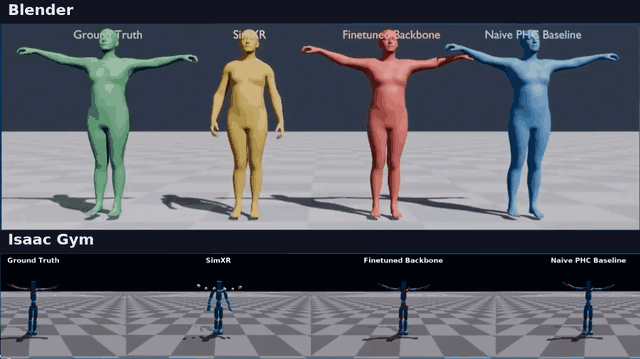
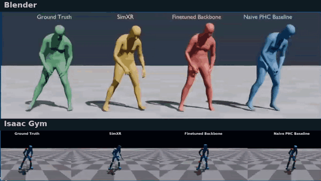
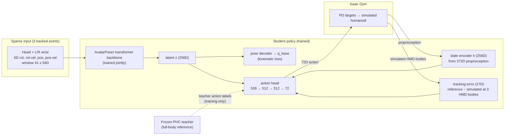

# Physics-Based Full-Body Avatars from Sparse VR Tracking: AvatarPoser + PHC

Can a policy that sees only a VR headset and two controllers drive a **physically simulated**
full-body avatar? This research record distils a physics-based motion controller (PHC) into a
student policy built on a sparse-input pose estimator (AvatarPoser). It evaluates that policy in
Isaac Gym on two datasets, against a physics-tracking baseline and a replicated SimXR ablation.

## Demonstrations

Two Quest2 test clips, each rendered side by side. Left to right: ground truth, the SimXR
no-vision baseline, the distilled student ("Finetuned Backbone", i.e. `trackerr`,
`student_0380160.pth`) and the naive PHC baseline. The top row is a Blender render of the motion
retargeted onto an SMPL-X body; the bottom row is the Isaac Gym simulation itself. The GIFs are
reduced to 640 px at 10 fps; the MP4 links give the full-quality originals.

| Walking (locomotion) | Range of motion (full-body) |
|:---:|:---:|
|  |  |
| [Full-quality MP4](docs/media/walking_clean.mp4) · [still](docs/media/walking_clean.png) | [Full-quality MP4](docs/media/range_of_motion_clean.mp4) · [still](docs/media/range_of_motion_clean.png) |

These are illustrative single clips. No selection criterion for them was recorded, so they say
nothing about average performance; the [Results](#results) tables are the evidence. The column labels follow
the project's convention (`Finetuned Backbone` = `trackerr`, as in `results_comparison.md`). The
exact render invocation was not recorded. The renders use
`scripts/blender_render_4way_mesh.py` and the SMPL-X Blender add-on (body model by MPI-IS,
subject to its own license).

## At a glance

- **Problem.** Three tracked points (head and wrists) under-determine full-body motion.
  Kinematic estimators are accurate but physically implausible: feet slide and penetrate the
  floor, and motion jitters. Physics controllers produce plausible motion but expect a full-body
  reference.
- **Approach.** A student policy (AvatarPoser transformer backbone, simulator-state encoder and
  action head) is distilled from a frozen PHC teacher. It sees only the sparse VR signal and its
  own proprioception, and drives a humanoid in Isaac Gym. It is evaluated on the SimXR Quest2
  synthetic dataset (1,072 test clips) and on AMASS (536 sequences).
- **Main findings.**
  - On Quest2, every early student scored 0% survival on locomotion. Diagnosing that as missing
    closed-loop feedback, and adding the student's own tracking error as an input, raised
    locomotion/dynamic survival from **0/461 to 236/461**.
  - The final student is **roughly at parity** with simply letting the frozen physics controller
    track the kinematic prediction: lower position error (87.4 vs. 96.4 mm), slightly lower
    survival (0.738 vs. 0.767), and worse rotation error and jitter.
  - It outperforms a replicated SimXR no-vision ablation on most metrics.
  - On AMASS, no distilled student beat that naive baseline.
- **Caveats.** Reported checkpoints were selected on the test set, and each result is a single
  run. Trained checkpoints were lost with the original workstation; see
  [Limitations](#limitations) and [Reproducibility](#reproducibility).
- **Contributions.**
  - The distillation pipeline for two humanoid rigs.
  - The closed-loop diagnosis and fix.
  - Evaluation and diagnostic tooling (physics metrics, mesh ground penetration, per-clip
    analyses).
  - Documented negative results (Stage R collapse, representation ablations).

  Details are in [Original contributions vs. upstream](#original-contributions-vs-upstream).

Research record: experiments run 2026-06 → 2026-09. This repository is a **fork of
[AvatarPoser](https://github.com/eth-siplab/AvatarPoser)** (Jiang et al., ECCV 2022). It is
combined with a modified fork of **[PHC](https://github.com/ZhengyiLuo/PHC)** (Luo et al., ICCV
2023), included as the `phc/` submodule, and evaluated against a local replication of the
**[SimXR](https://github.com/ZhengyiLuo/SimXR)** (Luo et al., CVPR 2024) no-vision ablation.
[Provenance and attribution](#provenance-and-attribution) separates the original work from the
upstream code.

> **Status.** This is a dated research record, not a maintained library. The trained student
> checkpoints, datasets and most evaluation dumps are **not** in Git (see
> [Reproducibility](#reproducibility)). Every number below is copied from
> [`results_comparison.md`](results_comparison.md), the authoritative results log, which carries
> the full footnotes and history.

**Contents:** [Demonstrations](#demonstrations) · [Research problem](#research-problem) ·
[Method](#method) · [Contributions](#original-contributions-vs-upstream) · [Results](#results) ·
[Key findings](#key-findings) · [Limitations](#limitations) · [Reproducibility](#reproducibility) ·
[Repository map](#repository-map) · [Attribution](#provenance-and-attribution)

---

## Research problem

A VR headset and its two controllers give only **three tracked points**: head and both wrists.
Kinematic regressors such as AvatarPoser predict accurate full-body poses from that signal, but
the poses are not physically constrained. Feet slide and penetrate the floor, and the motion
jitters. Physics-based controllers such as PHC produce physically valid motion, but they expect a
full-body reference to track.

**Question studied:** can a single student policy, conditioned only on sparse 3-point tracking,
drive a physically simulated humanoid that is both accurate and physically plausible? And does it
beat the simpler alternative of letting a frozen physics controller track the kinematic
prediction directly?

## Method

The student is distilled from a **frozen PHC teacher** that has full-body reference access. The
student itself only sees HMD/controller features and its own proprioception.



Two training stages are implemented:

- **Stage E: behaviour cloning.** DAgger-style action distillation against the frozen teacher,
  plus a kinematic loss on the decoded pose `q_base`. The student's own actions step the
  simulator. **All headline results use Stage E only.**
- **Stage R: PPO fine-tuning** of a Stage E checkpoint against a tracking reward. It helped
  briefly on AMASS, but collapses on Quest2 (see [Findings](#key-findings)).

The work runs on two pipelines:

| | AMASS / SMPL pipeline | Quest2 pipeline |
|---|---|---|
| Data | AMASS (AvatarPoser splits), 536-sequence PHC test set | SimXR Quest2 synthetic dataset, 4,097 train / **1,072 test** clips |
| Rig | `smpl_humanoid` | SimXR `quest_humanoid` (25 bodies, 72 DoF) |
| Teacher | PHC released checkpoints (`phc_kp_pnn_iccv` / `phc_kp_mcp_iccv`) | `phc_prim_quest`: md5-identical to the teacher in SimXR's config, and very likely the checkpoint SimXR's `download_data.sh` fetches (not byte-verified) |
| Backbone | Frozen pretrained AvatarPoser | AvatarPoser ported to `quest_humanoid`, trained jointly. Documented as warm-started from AMASS weights, but [unresolved](#reporting-status) |

**Baselines**

- **Naive PHC baseline:** no student. The frozen teacher tracks the backbone's raw kinematic
  prediction. This is the "just add physics afterwards" alternative, and the bar to beat.
- **Kinematics only (Phase A):** the AvatarPoser backbone alone, with no simulation.
- **SimXR no-vision ablation:** SimXR's own code, retrained here with the vision branch
  disabled and the same teacher, data split and termination threshold. This is **not** the
  published SimXR model, which also uses headset camera images.

## Original contributions vs. upstream

The table below scopes what was built in this project. It makes no claim of novelty beyond the
specific pipeline and analyses; tracking-error observations in particular are standard in PHC-style
imitation policies, and SimXR's own policy observes head tracking error.

| Area | What was done here | Where |
|---|---|---|
| Distillation pipeline | AvatarPoser-backbone student (backbone + state encoder + action head + value head), Stage E behaviour cloning, Stage R PPO, for both rigs | PHC fork: `phc/phc/learning/distill_agent.py`, `distill_agent_quest.py`, `phc/phc/data/cfg/learning/distill*.yaml` |
| AvatarPoser on Quest2 | Quest2 dataloader, differentiable FK on `quest_humanoid`, AMASS→Quest2 transfer fine-tuning, Quest2 evaluation | [`data/dataset_quest2.py`](data/dataset_quest2.py), [`models/quest_body_model.py`](models/quest_body_model.py), [`models/network_finetune.py`](models/network_finetune.py), [`models/model_avatarposer_finetune.py`](models/model_avatarposer_finetune.py), [`main_test_avatarposer_quest2.py`](main_test_avatarposer_quest2.py) |
| Closed-loop fix | Found why every earlier Quest2 student scored 0% on locomotion: the action head could not observe its own tracking error. Fixed with a deployable 27D heading-frame tracking-error input (`use_tracking_error`), plus an HMD-velocity fps fix | [`results_comparison.md`](results_comparison.md#root-cause-of-0-locomotion-found-2026-08-11-and-the-fix) |
| Evaluation tooling | Physics-rollout metric scripts, naive-baseline construction and temporal alignment, simulator-independent mesh ground penetration via Quest→SMPL-H IK, per-clip analysis, checkpoint scans | [`scripts/evaluate_phc_metrics_quest.py`](scripts/evaluate_phc_metrics_quest.py), [`scripts/evaluate_phc_metrics.py`](scripts/evaluate_phc_metrics.py), [`scripts/mesh_gpen_quest.py`](scripts/mesh_gpen_quest.py), [`scripts/score_naive_baseline_vs_gt.py`](scripts/score_naive_baseline_vs_gt.py), [`scripts/per_clip_metrics.py`](scripts/per_clip_metrics.py), [`utils/physical_metrics.py`](utils/physical_metrics.py) |
| Quest→SMPL retargeting | Joint correspondence, frame calibration, single-frame and sequence IK, PHC physics pass on retargeted motion, per-activity characterisation | [`scripts/retarget_quest_to_smpl.py`](scripts/retarget_quest_to_smpl.py), [`scripts/retarget_quest_to_smpl_sequence.py`](scripts/retarget_quest_to_smpl_sequence.py), [`scripts/quest_smpl_step6e_report.md`](scripts/quest_smpl_step6e_report.md), [`scripts/quest_smpl_charstudy_report.md`](scripts/quest_smpl_charstudy_report.md) |
| Diagnostics | Stage R collapse root cause, mesh-penetration excess, ankle/action-smoothness behaviour vs. teacher and SimXR | [`scripts/diag_fb_gpen/DIAGNOSIS.md`](scripts/diag_fb_gpen/DIAGNOSIS.md), [`scripts/diag_fb_multiclip/VERDICT.md`](scripts/diag_fb_multiclip/VERDICT.md), [`scripts/diag_simxr_ankle/VERDICT_SIMXR.md`](scripts/diag_simxr_ankle/VERDICT_SIMXR.md) |
| SimXR baseline | Re-ran SimXR's no-vision configuration and patched its evaluation player to dump rotations for the full metric set | [`scripts/simxr_novision/`](scripts/simxr_novision/README.md), [`simxr_ref/`](simxr_ref/README.md) |
| Rendering | Blender export and SMPL-X-addon rendering of simulated motion | [`scripts/BLENDER_EXPORT_README.md`](scripts/BLENDER_EXPORT_README.md), [`QUEST2_BLENDER_REPRODUCTION.md`](QUEST2_BLENDER_REPRODUCTION.md) |

**Modified upstream AvatarPoser files** (the original structure is kept and the ETH headers are
retained): `main_train_avatarposer.py`, `main_test_avatarposer.py`, `prepare_data.py`,
`data/dataset_amass.py`, `data/select_dataset.py`, `models/model_avatarposer.py`,
`models/model_base.py`, `models/network.py`, `models/select_model.py`,
`utils/utils_visualize.py`. Run `git diff 0f97cb2 -- <file>` against the last upstream commit to
see exactly what changed.

## Results

### Metric definitions

| Metric | Definition |
|---|---|
| **Success (`phc_survival`)** | Fraction of test sequences whose simulated episode is never terminated by PHC's 0.5 m tracking-error check. This is the headline success metric, and the closest to SimXR's per-sequence success. |
| Success (`frame_head`) | Per sequence, the fraction of frames with head error < 0.5 m, averaged over sequences. Looser, and saturates near 0.97–0.99. |
| MPJPE | Mean per-joint global position error vs. ground truth (Quest2: all 25 bodies, mm; AMASS: cm) |
| MPJRE | Mean per-joint rotation error (°) |
| MPJVE | Mean per-joint velocity error (cm/s) |
| Jitter | Mean norm of the joint-position third derivative (m/s³); lower is smoother |
| Foot skate | Height-gated horizontal foot velocity (cm/s); lower is better |
| Mesh GPen (Quest2) | Ground penetration of a reconstructed SMPL-H neutral mesh. Mean = mean depth over penetrating (vertex, frame) pairs; Rate = fraction of frames with any vertex below Z = 0. Every method passes through the same Quest→SMPL-H IK. |

**Pre-sim** values are measured on kinematic output before physics. **Post-sim** values are
measured on the simulated trajectory. The two are not comparable.

### Quest2 (SimXR synthetic dataset, 1,072 test clips)

The student is `trackerr`, checkpoint `student_0380160.pth` (Stage E, 380k steps): a jointly trained backbone plus the tracking-error input.

#### Reporting status

Read this before citing the table.

- **Test-set selection.** `student_0380160.pth` is the best of a full-range checkpoint scan
  ranked by `phc_survival` **on these same 1,072 test clips**
  ([`scripts/quest_checkpoint_scan.sh`](scripts/quest_checkpoint_scan.sh)). The SimXR column's
  epoch-1,500 checkpoint is likewise the test-set peak of 12. The Naive PHC baseline involves no
  selection. Final checkpoints score lower: `trackerr`@500k = 0.707 and SimXR final = 0.514
  `phc_survival`.
- **Verified against tracked files:** Naive PHC
  ([`quest2_naive_baseline_vs_gt.json`](results/baselines/quest2_naive_baseline_vs_gt.json)),
  Phase A
  ([`avatarposer_quest2_phase_a_finetuned.json`](results/baselines/avatarposer_quest2_phase_a_finetuned.json)),
  and all Mesh GPen rows
  ([`dataset_mesh_gpen_aggregate.json`](scripts/dataset_mesh_gpen_aggregate.json)).
- **Reported but not verifiable from this repository:** the student's post-sim metrics and
  per-activity rates (the eval JSON is untracked), and the SimXR column (its dumps live in the
  separate SimXR checkout).
- **The SimXR column mixes two evaluation runs.** Success and MPJPE come from SimXR's own
  evaluator (512 envs). MPJRE, MPJVE, jitter and foot skate come from this repo's script on a
  64-env re-run, which gave 0.7155 / 112.36 mm.
- **Unresolved: backbone initialisation.** `results_comparison.md` describes the student as
  warm-started from the AMASS-finetuned AvatarPoser. But the committed `distill_quest.yaml`
  default points at the from-scratch Quest2 backbone, and no override is recorded (see
  [`QUEST2_TRAINING_REPRODUCTION.md`](QUEST2_TRAINING_REPRODUCTION.md)). Which one was used is
  not established.

| Metric | Stage | Kinematics only (Phase A) | Naive PHC baseline | SimXR no-vision (replicated) | **Student (`trackerr`)** |
|---|---|---|---|---|---|
| Success `phc_survival` ↑ | post | n/a | **0.767** | 0.717 | 0.738 |
| Success `frame_head` ↑ | post | — | 0.974 | **0.997** | 0.989 |
| MPJPE (mm) ↓ | see note | *37.85* | 96.38 | 112.5 | **87.43** |
| MPJRE (°) ↓ | see note | *10.65* | **13.82** | 29.76 | 15.23 |
| MPJVE (cm/s) ↓ | see note | *14.50* | **24.17** | 40.93 | 34.25 |
| Jitter (m/s³) ↓ | see note | *136.46* | **221.94** | 704.29 | 524.78 |
| Foot skate (cm/s) ↓ | see note | *23.34* | 21.41 | **14.39** | 17.14 |
| Mesh GPen mean (mm) ↓ | pre | 3.27 | 3.27 (same stream) | n/a | 4.48 |
| Mesh GPen rate ↓ | pre | 0.018 | 0.018 (same stream) | n/a | 0.024 |
| Mesh GPen mean (mm) ↓ | post | n/a | **2.56** | 3.30 | 6.03 |
| Mesh GPen rate ↓ | post | n/a | **0.020** | 0.031 | 0.041 |

Note: Phase A values (italic) are **pre-simulation** and not comparable to the post-simulation
columns. Ground-truth motion through the same mesh pipeline gives a pre-sim GPen of 1.72 mm /
0.017. SimXR maps sensors directly to actions, so it has no pre-sim pose. The student's post-sim
GPen excess is partly a reconstruction artefact: the Quest rig has no toe joint, and 30.8% of the
student's penetrating frames are airborne (see
[`scripts/diag_fb_gpen/DIAGNOSIS.md`](scripts/diag_fb_gpen/DIAGNOSIS.md)).

**Effect of the closed-loop fix.** On the 461 locomotion and dynamic clips, success went from
**0/461 → 236/461 (0.512)**. Per activity, `phc_survival` was:

| Activity | Before fix (`finetuned_backbone`) | **After fix (`trackerr`)** | Naive baseline |
|---|---|---|---|
| walking | 0.000 | **0.812** | 0.792 |
| jogging | 0.000 | 0.390 | **0.779** |
| interactions | 0.000 | **0.573** | 0.533 |
| dancing | 0.000 | 0.250 | **0.500** |
| standing | 0.689 | 0.985 | 0.985 |
| whiteboard | 0.647 | 0.968 | **0.974** |
| gestures | 0.314 | **0.893** | 0.830 |
| ROM | 0.600 | **0.800** | 0.762 |

### Qualitative examples (Quest2)

The Walking and Range of Motion comparisons are shown in
[Demonstrations](#demonstrations) at the top of this page.

### AMASS / SMPL (536-sequence PHC test set)

All rows below are post-simulation. MPJPE is in **cm**. `v7_validate` was selected by an
early-stop sweep scored on this same test set ([`scripts/auto_eval.sh`](scripts/auto_eval.sh) →
`phc_test.pkl`).

| Model | Success ↑ | MPJPE (cm) ↓ | MPJRE (°) ↓ | Jitter (m/s³) ↓ | Foot skate (cm/s) ↓ |
|---|---|---|---|---|---|
| **Naive PHC baseline** (frozen teacher tracks AvatarPoser output) | **0.912** | **14.06** | **18.93** | **318** | **0.88** |
| `frozen_bb`: frozen backbone, action head only | 0.584 | 34.83 | 38.73 | 1188 | 2.66 |
| `v7`: Stage E distillation | 0.545 | 38.18 | 40.31 | 1337 | 2.41 |
| `v7_validate`: `v7` + 6k Stage R steps (best student) | 0.756 | 24.59 | 34.83 | 773 | 1.66 |

For reference, kinematic AvatarPoser alone (pre-sim) gets 2.51 cm MPJPE, 1357 m/s³ jitter and
33.67 cm/s foot skate. The full table, including negative variants (`v8`, `goal-delta-input`) and
Stage R checkpoints, is in [`results_comparison.md`](results_comparison.md#amasssmpl-pipeline).

### Key findings

1. **On AMASS, no distilled student beats the naive baseline** (best 0.756 vs. 0.912 success).
   The AMASS student shares the structural defect fixed on Quest2: it cannot observe its own
   tracking error. Whether the same fix closes this gap is an open question, untested.
2. **On Quest2, the missing closed-loop signal was the bottleneck.** Every pre-fix variant
   (from-scratch, pure action loss, explicit-pose conditioning, AMASS warm-start) scored 0% on
   locomotion. Adding the tracking-error input brought the student roughly to parity with the
   naive baseline, a mixed result rather than a clear win:
   - Better than naive on MPJPE (87.4 vs. 96.4 mm), foot skate and `frame_head` success.
   - Slightly lower survival (0.738 vs. 0.767).
   - Worse on MPJRE, MPJVE, jitter and mesh GPen.
3. **The student outperforms the replicated SimXR no-vision ablation on most metrics**: survival,
   MPJPE, MPJRE, MPJVE and jitter. It is worse on foot skate, `frame_head` success and post-sim
   mesh GPen. These comparisons share the same teacher, split and termination threshold.
4. **Representation choice was not the bottleneck.** Feeding the action head the explicit
   decoded pose instead of the latent made no measurable difference on either pipeline.
5. **Stage R (PPO) collapses on Quest2.** The root cause is a critic that Stage E never trains.
   Critic warm-up reduced but did not prevent the collapse. Two further suspects (KL-adaptive LR,
   critic gradients into the shared trunk) are documented but not tested.
6. **Training is noisy.** Adjacent checkpoints differ by up to ±0.10 success, so early stopping is
   unreliable for this recipe and single-checkpoint comparisons are not meaningful.

## Limitations

- **Test-set checkpoint selection.** These were all chosen by scanning success on the test set
  itself, with no separate validation split:
  - the reported Quest2 student checkpoint;
  - the SimXR ablation's epoch-1,500 peak;
  - the AMASS `v7_validate` checkpoint.

  The trained methods' headline numbers are therefore optimistic relative to the naive baseline,
  which needs no selection.
- **Single seed, single run.** There are no confidence intervals. Training is seeded but not
  deterministic (Isaac Gym GPU physics, `torch_deterministic=False`).
- **Subject overlap.** The SimXR Quest2 split is a random 8:2 split by take: 30.4% of test clips
  come from subjects seen in training (on other activities). Treat results as clip-level, not
  subject-independent.
- **Synthetic data.** The Quest2 data is SimXR's synthetic dataset; nothing here is evaluated on
  live headset recordings.
- **Metric differences from published work.** MPJPE here averages all 25 bodies; SimXR's paper
  uses 11 common joints. The SimXR column is a local no-vision replication, so compare against
  SimXR's published tables only approximately.
- **Weak categories.** `martialarts` (0/9) and `sports` (5/45) remain near zero.
- **Physics does not improve kinematic accuracy.** In the 10-clip retargeting characterisation
  study, a frozen PHC pass removed penetration and mostly reduced foot skate, but increased MPJPE
  on all 10 clips (see
  [`scripts/quest_smpl_charstudy_report.md`](scripts/quest_smpl_charstudy_report.md)).

## Reproducibility

| Document | Contents |
|---|---|
| [`results_comparison.md`](results_comparison.md) | All results, footnotes, eval commands, dataset caveats, historical runs |
| [`QUEST2_TRAINING_REPRODUCTION.md`](QUEST2_TRAINING_REPRODUCTION.md) | Code-path trace for training and evaluating the reported Quest2 student, with required files and known gaps |
| [`QUEST2_BLENDER_REPRODUCTION.md`](QUEST2_BLENDER_REPRODUCTION.md) | Rendering and mesh-penetration pipelines |
| [`results_per_clip_renders.md`](results_per_clip_renders.md) | Per-clip metrics for the rendered clips |
| [`docs/MIGRATION.md`](docs/MIGRATION.md) | Full environment setup (conda, Isaac Gym), data inventory, body-model requirements, hardcoded-path notes |
| [`scripts/simxr_novision/README.md`](scripts/simxr_novision/README.md) | Re-running the SimXR baseline |
| [`docs/DATA_AND_ARTIFACTS.md`](docs/DATA_AND_ARTIFACTS.md) | What is included, external dependencies, dataset acquisition, artifacts that were **not preserved**, and what each reported result rests on |
| [`docs/PHC_SUBMODULE.md`](docs/PHC_SUBMODULE.md) | The public PHC fork, research↔publication commit mapping, and the SimXR install step required for Quest2 |
| [`simxr_ref/README.md`](simxr_ref/README.md) | SimXR evaluation instrumentation: what was changed and how to re-apply it to an official checkout |

**Environment.** Python 3.8, PyTorch 2.4.1 (CUDA 12.1), Isaac Gym Preview 4. There are two conda
environments: [`setup/environment-avatarposer.yml`](setup/environment-avatarposer.yml) for
kinematic training and metrics, and [`setup/environment-rlgpu.yml`](setup/environment-rlgpu.yml)
for PHC and Isaac Gym.

**Quest2 needs SimXR.** SimXR declares no license, so no SimXR-derived code is distributed. Quest2
work needs [SimXR](https://github.com/ZhengyiLuo/SimXR) at
`39081b831aa1c1e52a4a974fb78a1ed93f7580c2`. It provides the Quest rig, configs and motion
library, which are rebuilt into `phc/` by `phc/scripts/install_simxr_quest_files.py` (see
[`docs/PHC_SUBMODULE.md`](docs/PHC_SUBMODULE.md#setup-order)). It also provides the SimXR
baseline. The AMASS/SMPL pipeline does not need SimXR.

**Not included:**

- datasets (AMASS, SimXR Quest2 synthetic data), body models, Isaac Gym and the PHC/SimXR teacher
  checkpoints, which must be obtained from their sources;
- trained student checkpoints, rollout dumps and most evaluation outputs, which were **lost with
  the original workstation** and cannot be recovered;
- per-frame action and trajectory dumps derived from SimXR or AMASS data, which are excluded and
  regenerable.

Details and the evidence behind each result are in
[`docs/DATA_AND_ARTIFACTS.md`](docs/DATA_AND_ARTIFACTS.md).

**Pretrained AvatarPoser checkpoint (not included).** The AMASS kinematic baseline and the
AMASS→Quest2 warm start use upstream AvatarPoser's pretrained model. It was trained on AMASS,
whose license is non-commercial and forbids training networks for commercial use, and upstream
does not grant explicit permission to redistribute the weights. Download it from the official
release instead:

```bash
mkdir -p model_zoo
curl -L -o model_zoo/avatarposer.pth \
  https://github.com/eth-siplab/AvatarPoser/releases/download/v1.0/avatarposer.pth
echo "02f8888e807579771a7e9959160d1461b62b7112a1e99557aae76bedc46f9e76  model_zoo/avatarposer.pth" | sha256sum -c
```

**Main entry points:**

```bash
# Kinematic AvatarPoser (Quest2 rig): train / evaluate
python main_train_avatarposer.py -opt options/train_avatarposer_quest2_finetune.json
python main_test_avatarposer_quest2.py -opt <options.json> -ckpt <checkpoint.pth>

# Physics rollout + metrics for a distilled student (wraps PHC's run_hydra.py)
bash scripts/auto_eval_quest.sh <exp_name> <target_step>
bash scripts/quest_checkpoint_scan.sh <exp_name> [eval_interval] [patience]
```

Several shell scripts hardcode the original workstation paths (`/home/sia-irl/...`). See
[`docs/MIGRATION.md` §6](docs/MIGRATION.md#6-the-hardcoded-path-problem).

> **Submodule note.** In the public release, `phc/` points at
> [`PHC-AvatarPoser`](https://github.com/thelastlaughstandstrong/PHC-AvatarPoser) @
> `413516d081f0`. This is a clean copy of the private research fork, with SimXR-derived files
> excluded from its history. The results were produced at private commit `759f0904`, which
> corresponds to `research-pin/759f0904` (`e31fdfeddb24`). Older commits of this repository pin
> private SHAs; see the mapping in [`docs/PHC_SUBMODULE.md`](docs/PHC_SUBMODULE.md).

## Repository map

```
main_*_avatarposer*.py    AvatarPoser train/test entry points (upstream, extended; *_quest2 is new)
data/, models/, utils/    AvatarPoser code (upstream) + Quest2 dataset/FK/finetune modules (new)
options/                  JSON configs (upstream AMASS + new Quest2 configs)
phc/                      PHC fork (submodule): distillation agents, Quest configs
scripts/                  Evaluation, retargeting, rendering, diagnostics, reports (*.md, *.json)
results/baselines/        Small JSON metric snapshots backing the tables
simxr_ref/                SimXR eval-instrumentation record (README only; SimXR code not included)
setup/                    Conda environment exports
*.log (root)              Raw logs from Stage R / critic warm-up experiments
```

## Provenance and attribution

- **AvatarPoser**: © 2022 ETH Sensing, Interaction & Perception Lab, MIT License (see
  [`LICENSE`](LICENSE)). This repository was forked from
  [eth-siplab/AvatarPoser](https://github.com/eth-siplab/AvatarPoser). Commits up to `0f97cb2`
  (2025-02-20) are upstream; all later commits are this project's. The backbone architecture and
  the original AMASS pipeline are AvatarPoser's.
- **PHC**: © 2023 Carnegie Mellon University and © 2018–2023 NVIDIA Corporation, BSD 3-Clause
  Clear License. The physics controller, Isaac Gym environments, motion libraries and released
  teacher checkpoints are PHC's. This project's changes live in a fork used as the `phc/`
  submodule. Its `NOTICE` separates upstream code from this project's additions.
- **SimXR**: the `quest_humanoid` rig, the Quest2 synthetic dataset, the teacher checkpoint
  `phc_prim_quest` and the no-vision training configuration are SimXR's. SimXR declares no
  license, so no SimXR source code, and no data derived from its dataset at motion level, is
  distributed here. Users obtain SimXR themselves; this repository ships only edit scripts with
  this project's own changes.
- **Datasets and body models**: AMASS, SMPL, SMPL-H and DMPL are subject to their own
  registration-based licenses and are not redistributed here. The two raw AMASS sample sequences
  that upstream AvatarPoser ships (`support_data/github_data/*_sample.npz`) are also excluded.

If you build on this work, please cite the upstream papers:

```bibtex
@inproceedings{jiang2022avatarposer,
  title     = {AvatarPoser: Articulated Full-Body Pose Tracking from Sparse Motion Sensing},
  author    = {Jiang, Jiaxi and Streli, Paul and Qiu, Huajian and Fender, Andreas and Laich, Larissa and Snape, Patrick and Holz, Christian},
  booktitle = {European Conference on Computer Vision (ECCV)},
  year      = {2022}
}
@inproceedings{luo2023perpetual,
  title     = {Perpetual Humanoid Control for Real-time Simulated Avatars},
  author    = {Luo, Zhengyi and Cao, Jinkun and Winkler, Alexander and Kitani, Kris and Xu, Weipeng},
  booktitle = {International Conference on Computer Vision (ICCV)},
  year      = {2023}
}
@inproceedings{luo2024real,
  title     = {Real-Time Simulated Avatar from Head-Mounted Sensors},
  author    = {Luo, Zhengyi and Cao, Jinkun and Khirodkar, Rawal and Winkler, Alexander and Kitani, Kris and Xu, Weipeng},
  booktitle = {IEEE/CVF Conference on Computer Vision and Pattern Recognition (CVPR)},
  year      = {2024}
}
```
