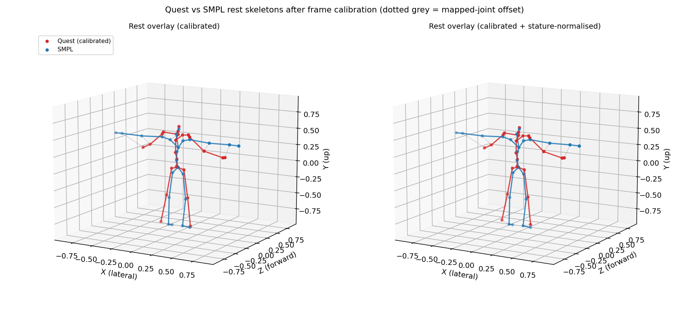

# Quest <-> SMPL Rest-Frame Calibration (Step 3)

## 1. Axis conventions (derived from rest geometry, not assumed)

Frames are built from landmarks that exist in both skeletons with a direct 1:1 mapping (`root`, `head`, `l_hip`, `r_hip`), so no discarded or merged joint influences the result.

| | Quest | SMPL |
|---|---|---|
| up (root→head) | `[0.9983, 0.0577, 0.0]` ≈ **+X** (3.31° off) | `[0.0118, 0.9998, 0.0144]` ≈ **+Y** (1.07° off) |
| right (L hip→R hip) | `[0.0, 0.0, -1.0]` ≈ **-Z** (0.00° off) | `[-0.9998, 0.0115, 0.0183]` ≈ **-X** (1.24° off) |
| forward (up × right) | `[-0.0577, 0.9983, 0.0]` ≈ **+Y** (3.31° off) | `[0.0181, -0.0146, 0.9997]` ≈ **+Z** (1.33° off) |

So **Quest is X-up / Y-forward / Z-left**, and **SMPL is Y-up / Z-forward / X-left**.

| property | result |
|---|---|
| handedness | `det(R) = 1.000000` → **right-handed, preserved** (no reflection; a mirrored skeleton would give −1) |
| orthonormality | max &#124;RRᵀ−I&#124; = 9.62e-18 → exact |
| units | Quest stature 1.4848 m vs SMPL 1.4443 m → **both metres**, ratio 1.0280 |
| root orientation | both rest poses have the root at the origin after centring; the residual root rotation is entirely absorbed by R |

## 2. The fixed transform

```
R (Quest frame -> SMPL frame), row-major:
  [ 0.010716  0.018740  0.999767]
  [ 0.999008  0.043024 -0.011514]
  [-0.043230  0.998898 -0.018260]

quaternion xyzw : [0.496476, 0.512486, 0.481664, 0.508793]
euler xyz (deg) : [91.047, 2.478, 89.385]
```

This lands **2.764°** away from the idealized quaternion `[0.5, 0.5, 0.5, 0.5]` (a 120° rotation about [1,1,1]/√3) that this repo already uses for PHC's `upright_start` convention. That near-match is a strong independent check: the transform recovered purely from rest-pose landmark geometry reproduces the convention the codebase encodes by hand. The small deviation is real, not noise — it is the rest poses' own tilt (Quest's up axis carries a 3.31° lean, SMPL's 0.98°), which the exact-120° idealization discards.

## 3. Is the transform correct? Limb-direction check

A frame error would misalign **every** limb equally. It does not:

| chain | Quest (calibrated) | SMPL | angle |
|---|---|---|---|
| hip→ankle | `[0.122, -0.992, -0.04]` | `[0.027, -0.998, -0.062]` | **5.61°** |
| shoulder→wrist | `[0.722, -0.607, 0.332]` | `[0.998, -0.007, -0.056]` | **45.01°** |

The legs agree to **5.61°**, which confirms the transform is right. The arms differ by **45.01°** for a different reason: **Quest's rest pose is an A-pose and SMPL's is a T-pose.** Arm span corroborates this — Quest 1.060 m vs SMPL 1.365 m; an A-pose brings the wrists closer together.

> **This matters for reading the next table.** The pre-IK offsets below conflate two things: (a) the A-pose/T-pose *rest convention* difference, which is pure joint rotation and which IK removes **entirely**, and (b) genuine proportional/topological differences, which it cannot. The arm-chain numbers (elbows, wrists) are dominated by (a) and therefore **must not be read as a residual floor**. The leg numbers are the informative ones here, because the legs are in near-identical rest configuration in both skeletons.

## 4. Per-joint offsets AFTER calibration, BEFORE any IK

Both skeletons root-centred, Quest rotated by R. These are rest-pose-to-rest-pose distances: they measure how differently the two skeletons are *built*, and are the floor the IK stage starts from. `scaled` additionally applies a uniform stature normalisation (×0.9727) to separate proportional differences from a pure size difference.

### Group A — high confidence

| joint | Quest | SMPL | offset (mm) | scaled (mm) |
|---|---|---|---|---|
| `head` | `b_head` | `Head` | 38.0 | 21.3 |
| `l_elbow` | `b_l_forearm` | `L_Elbow` | 163.0 | 175.0 |
| `r_elbow` | `b_r_forearm` | `R_Elbow` | 157.5 | 169.5 |
| `l_wrist` | `b_l_wrist` | `L_Wrist` | 341.7 | 350.7 |
| `r_wrist` | `b_r_wrist` | `R_Wrist` | 347.3 | 355.9 |
| `l_hip` | `b_l_upleg` | `L_Hip` | 65.6 | 66.0 |
| `r_hip` | `b_r_upleg` | `R_Hip` | 67.0 | 67.2 |
| `l_knee` | `b_l_leg` | `L_Knee` | 36.7 | 43.3 |
| `r_knee` | `b_r_leg` | `R_Knee` | 49.6 | 56.0 |
| `l_ankle` | `b_l_foot_twist` | `L_Ankle` | 93.0 | 92.7 |
| `r_ankle` | `b_r_foot_twist` | `R_Ankle` | 116.2 | 116.7 |

**Group A — high confidence mean: 134.1 mm** (scaled 137.7 mm), max 347.3 mm

### Group B — structurally mismatched

| joint | Quest | SMPL | offset (mm) | scaled (mm) |
|---|---|---|---|---|
| `l_shoulder` | `b_l_arm` | `L_Shoulder` | 44.8 | 31.3 |
| `r_shoulder` | `b_r_arm` | `R_Shoulder` | 47.2 | 34.3 |
| `l_thorax` | `b_l_shoulder` | `L_Thorax` | 111.3 | 103.8 |
| `r_thorax` | `b_r_shoulder` | `R_Thorax` | 120.2 | 112.7 |
| `neck` | `b_neck0` | `Neck` | 48.9 | 40.1 |

**Group B — structurally mismatched mean: 74.5 mm** (scaled 64.4 mm), max 120.2 mm

**Mean over all 16 mapped joints: 115.5 mm** (scaled 114.8 mm). Synthesized joints (hands, toes) excluded, per the Step 2 validation protocol.

## 5. Overlay



Red = Quest after applying R; blue = SMPL; dotted grey lines join mapped pairs, so their length is the per-joint offset tabulated above.

