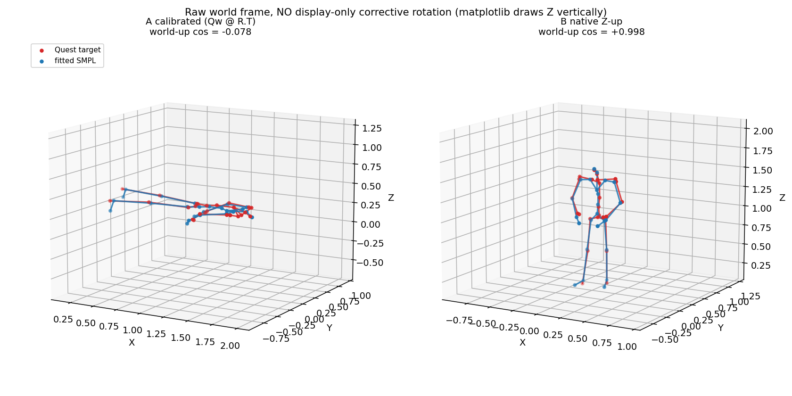

# World-Frame Convention Ablation (Step 4b)

**A = `calibrated`** (Step 4 reference): targets are `Qw @ R.T` — the fitted anatomical R is applied to world coordinates.  
**B = `native`**: targets stay in Quest's own Z-up world; `root_orient` carries SMPL-rest → Quest-world.

Identical for both: correspondence, rest offsets, loss (A=1.0 B=0.3, reg=0.001), initialization rule, Adam lr=0.05, 3000 iters, fixed neutral shape/scale. Only `build_targets` differs.

## Residuals

| clip | frame | conv | GrpA mean | GrpA max | GrpB mean | GrpB max | all mean | all max |
|---|---|---|---|---|---|---|---|---|
| `SUBJECT069.standing.pkl_0_42` | 200 | A | 29.0 | 46.4 | 45.8 | 90.6 | 34.3 | 90.6 |
| `SUBJECT069.standing.pkl_0_42` | 200 | B | 29.0 | 46.4 | 45.8 | 90.6 | 34.3 | 90.6 |
| `SUBJECT069.standing.pkl_0_42` | 60 | A | 27.3 | 36.3 | 44.9 | 85.8 | 32.8 | 85.8 |
| `SUBJECT069.standing.pkl_0_42` | 60 | B | 27.3 | 36.3 | 44.9 | 85.8 | 32.8 | 85.8 |
| `SUBJECT069.standing.pkl_0_42` | 350 | A | 29.0 | 47.0 | 45.0 | 94.1 | 34.0 | 94.1 |
| `SUBJECT069.standing.pkl_0_42` | 350 | B | 29.0 | 47.0 | 45.0 | 94.1 | 34.0 | 94.1 |
| `SUBJECT084.walking.pkl_0_426` | 150 | A | 28.3 | 39.3 | 49.7 | 84.5 | 35.0 | 84.5 |
| `SUBJECT084.walking.pkl_0_426` | 150 | B | 28.3 | 39.3 | 49.7 | 84.5 | 35.0 | 84.5 |
| `SUBJECT072.gestures.pkl_1281` | 200 | A | 32.9 | 58.3 | 71.7 | 124.0 | 45.1 | 124.0 |
| `SUBJECT072.gestures.pkl_1281` | 200 | B | 32.9 | 58.3 | 71.7 | 124.0 | 45.1 | 124.0 |

Mean over the 5 frames — **A 36.22 mm**, **B 36.22 mm** (difference 0.000 mm).

## Sanity / frame diagnostics

| clip | frame | conv | upright cos (rel.) | **world-up cos (abs.)** | lat cos | det | max ang | root err mm | final loss |
|---|---|---|---|---|---|---|---|---|---|
| `SUBJECT069.standing.pkl_` | 200 | A | 0.9998 | **-0.0776** | 0.9995 | +1.000 | 49.0° | 46.1 | 0.004405 |
| `SUBJECT069.standing.pkl_` | 200 | B | 0.9998 | **+0.9979** | 0.9995 | +1.000 | 49.0° | 46.1 | 0.004405 |
| `SUBJECT069.standing.pkl_` | 60 | A | 0.9999 | **-0.0105** | 0.9999 | +1.000 | 29.8° | 40.5 | 0.002228 |
| `SUBJECT069.standing.pkl_` | 60 | B | 0.9999 | **+0.9999** | 0.9999 | +1.000 | 29.8° | 40.5 | 0.002228 |
| `SUBJECT069.standing.pkl_` | 350 | A | 0.9996 | **+0.0172** | 0.9969 | +1.000 | 50.2° | 45.3 | 0.004504 |
| `SUBJECT069.standing.pkl_` | 350 | B | 0.9996 | **+0.9994** | 0.9969 | +1.000 | 50.2° | 45.3 | 0.004504 |
| `SUBJECT084.walking.pkl_0` | 150 | A | 1.0000 | **+0.0487** | 0.9721 | +1.000 | 40.1° | 51.1 | 0.002897 |
| `SUBJECT084.walking.pkl_0` | 150 | B | 1.0000 | **+0.9978** | 0.9721 | +1.000 | 40.1° | 51.1 | 0.002897 |
| `SUBJECT072.gestures.pkl_` | 200 | A | 0.9998 | **+0.0972** | 0.9993 | +1.000 | 56.8° | 39.0 | 0.006020 |
| `SUBJECT072.gestures.pkl_` | 200 | B | 0.9998 | **+0.9932** | 0.9993 | +1.000 | 56.8° | 39.0 | 0.006020 |

`upright cos (rel.)` compares the fit to its own target and passes either way. **`world-up cos (abs.)` is the decisive column**: the cosine between the fitted body's up axis and the WORLD `+Z` axis. ~+1 means the result stands upright in the world with no display-only corrective rotation; ~0 means it does not.

## Overlay (raw world frame, no display correction)

