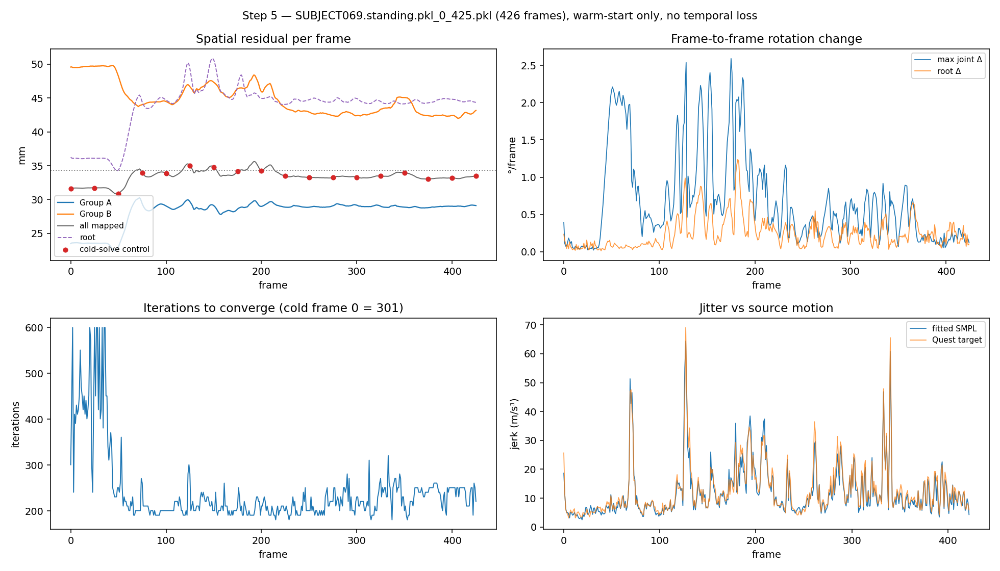
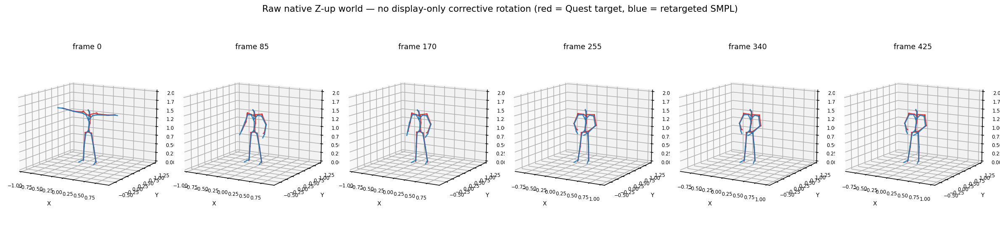

# Quest → SMPL Full-Sequence Retarget (Step 5)

- clip: `SUBJECT069.standing.pkl_0_425.pkl` — **426 frames** @ 30 fps
- world frame **native Z-up**, neutral SMPL, **scale fixed**, `lambda_root=0.25`
- warm start from frame t−1; **no temporal smoothness loss** (deliberately)
- frame 0 cold ≤3000 iters; warm frames ≤600, early-stop tol 1e-06
- wall clock **137.3s** (322 ms/frame)

## Spatial fit over the sequence

| metric | mean | max | Step 4 single-frame reference |
|---|---|---|---|
| Group A (mm) | **28.2** | 52.9 | 29.0 |
| Group B (mm) | **44.9** | 94.9 | 45.8 |
| all mapped (mm) | **33.4** | 94.9 | 34.3 |
| root translation (mm) | **43.7** | 50.8 | 45.0 |

Per-frame all-mapped residual: min 30.8, median 33.4, max 35.6 mm (std 0.9).

## Warm-start effectiveness

| | frame 0 (cold) | warm frames |
|---|---|---|
| iterations | 301 | mean **243**, median 221, max 600 |

Warm-started frames converge in **243** iterations vs **301** for the cold start — a **1.2×** reduction at the same tolerance.

**Drift control** — every 25th frame was ALSO solved cold (independent, Step-4 style) and compared against the warm-started result:

- warm all-mapped at those frames: **33.37 mm**
- cold all-mapped at those frames: **33.38 mm**
- max |warm − cold| over 18 checks: **0.004 mm**

A small max difference means warm-starting is not accumulating error down the sequence — it reaches the same optimum as an independent solve, just faster.

## Temporal quality (no smoothing applied)

| quantity | mean | p99 | max |
|---|---|---|---|
| joint rotation change (°/frame) | 0.12 | 1.36 | 2.59 |
| root rotation change (°/frame) | 0.24 | 0.99 | 1.24 |
| joint velocity (m/s) | 0.076 | 0.685 | 1.215 |
| joint acceleration (m/s²) | 0.46 | 3.14 | 16.26 |
| jitter / jerk (m/s³) | 12.1 | 87.0 | 489.5 |

Same quantities on the **Quest target motion** (the source, i.e. the floor any faithful retarget should approach — not zero):

| quantity | fitted SMPL | Quest target | ratio |
|---|---|---|---|
| velocity (m/s) | 0.076 | 0.078 | 0.98× |
| acceleration (m/s²) | 0.46 | 0.48 | 0.97× |
| jerk (m/s³) | 12.1 | 12.7 | 0.95× |

**Discontinuities / rotational flips**: 0 frame(s) exceeded the outlier threshold (20.0°/frame) — **none detected**.

## Sanity over all frames

| check | range | verdict |
|---|---|---|
| upright cos (vs target) | 0.9995 … 1.0000 | PASS |
| **world-up cos (absolute)** | +0.9931 … +1.0000 | PASS — upright in native Z-up |
| left/right cos | 0.9887 … 1.0000 | PASS |
| handedness det | +1.000 … +1.000 | PASS |
| max joint angle | 14.4° … 55.4° | PASS |
| all finite | True | PASS |

## Visualization

