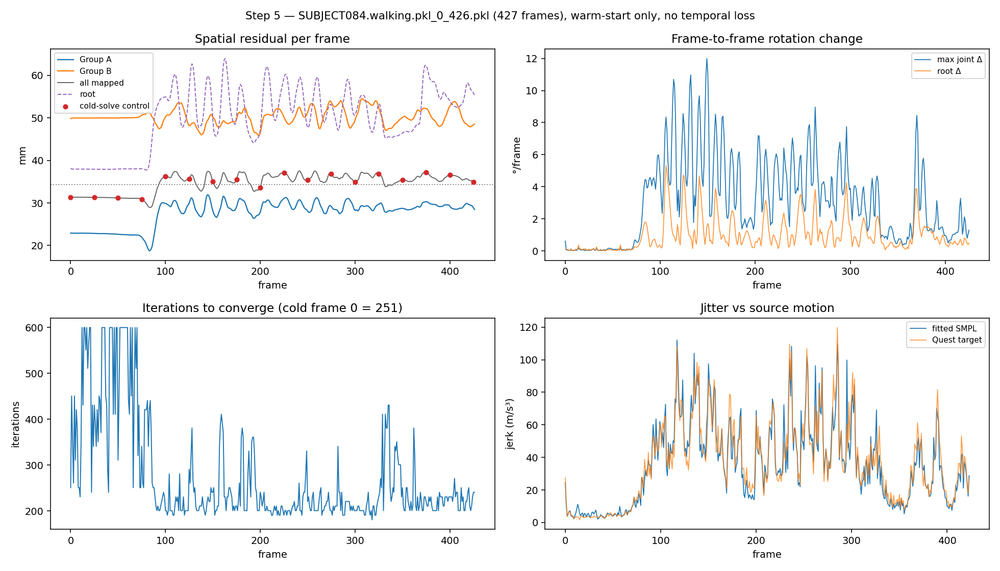
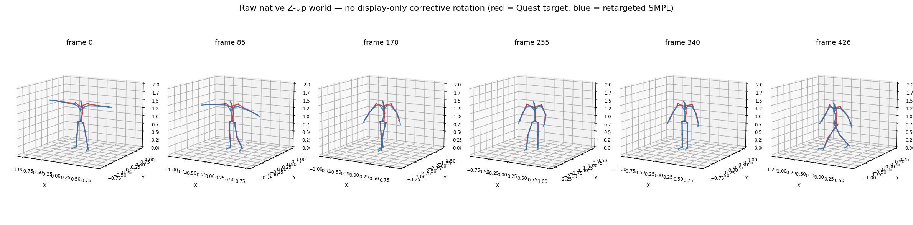

# Quest → SMPL Full-Sequence Retarget (Step 5)

- clip: `SUBJECT084.walking.pkl_0_426.pkl` — **427 frames** @ 30 fps
- world frame **native Z-up**, neutral SMPL, **scale fixed**, `lambda_root=0.25`
- warm start from frame t−1; **no temporal smoothness loss** (deliberately)
- frame 0 cold ≤3000 iters; warm frames ≤600, early-stop tol 1e-06
- wall clock **156.2s** (366 ms/frame)

## Spatial fit over the sequence

| metric | mean | max | Step 4 single-frame reference |
|---|---|---|---|
| Group A (mm) | **27.7** | 62.9 | 29.0 |
| Group B (mm) | **50.3** | 94.3 | 45.8 |
| all mapped (mm) | **34.7** | 94.3 | 34.3 |
| root translation (mm) | **49.9** | 64.0 | 45.0 |

Per-frame all-mapped residual: min 28.9, median 35.4, max 37.5 mm (std 2.2).

## Warm-start effectiveness

| | frame 0 (cold) | warm frames |
|---|---|---|
| iterations | 251 | mean **276**, median 231, max 600 |

Warm-started frames converge in **276** iterations vs **251** for the cold start — a **0.9×** reduction at the same tolerance.

**Drift control** — every 25th frame was ALSO solved cold (independent, Step-4 style) and compared against the warm-started result:

- warm all-mapped at those frames: **34.77 mm**
- cold all-mapped at those frames: **34.77 mm**
- max |warm − cold| over 18 checks: **0.004 mm**

A small max difference means warm-starting is not accumulating error down the sequence — it reaches the same optimum as an independent solve, just faster.

## Temporal quality (no smoothing applied)

| quantity | mean | p99 | max |
|---|---|---|---|
| joint rotation change (°/frame) | 0.53 | 4.71 | 11.99 |
| root rotation change (°/frame) | 0.99 | 4.57 | 5.31 |
| joint velocity (m/s) | 0.478 | 2.466 | 4.077 |
| joint acceleration (m/s²) | 2.25 | 15.05 | 43.71 |
| jitter / jerk (m/s³) | 35.7 | 254.6 | 918.4 |

Same quantities on the **Quest target motion** (the source, i.e. the floor any faithful retarget should approach — not zero):

| quantity | fitted SMPL | Quest target | ratio |
|---|---|---|---|
| velocity (m/s) | 0.478 | 0.469 | 1.02× |
| acceleration (m/s²) | 2.25 | 2.08 | 1.08× |
| jerk (m/s³) | 35.7 | 36.5 | 0.98× |

**Discontinuities / rotational flips**: 0 frame(s) exceeded the outlier threshold (24.3°/frame) — **none detected**.

## Sanity over all frames

| check | range | verdict |
|---|---|---|
| upright cos (vs target) | 0.9997 … 1.0000 | PASS |
| **world-up cos (absolute)** | +0.9788 … +1.0000 | CHECK |
| left/right cos | 0.9600 … 1.0000 | PASS |
| handedness det | +1.000 … +1.000 | PASS |
| max joint angle | 6.3° … 50.7° | PASS |
| all finite | True | PASS |

## Visualization

