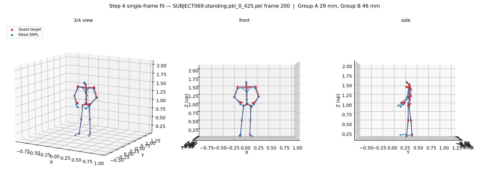

# Quest -> SMPL Single-Frame IK Fit (Step 4)

- clip: `SUBJECT069.standing.pkl_0_425.pkl` frame **200** of 426
- SMPL: neutral, **shape/betas and global scale held fixed**, rest offsets fixed
- world frame: **`native`**  (Quest-native Z-up; `root_orient` carries SMPL-rest → world)
- optimizer: Adam, lr 0.05 (StepLR ×0.3), **3000 iters**; weights A=1.0 B=0.3, pose reg 0.001
- arm/A-pose initialization: **not used**

initial loss **0.098672** → final **0.004405** (22× reduction); plateaued: **yes** (last-200-iter relative std 4.89e-16)

## Residuals

| group | mean (mm) | max (mm) | pre-IK mean (mm) |
|---|---|---|---|
| **A — high confidence** (11) | **29.0** | 46.4 | 134.1 |
| **B — structural mismatch** (5) | **45.8** | 90.6 | 74.5 |
| all mapped (16) | 34.3 | 90.6 | 115.5 |

Synthesized joints (hands, toes) are excluded from the optimization and from this table, per the Step 2 protocol.

### Per-joint

| group | joint | Quest | SMPL | pre-IK (mm) | post-IK (mm) | change |
|---|---|---|---|---|---|---|
| A | `head` | `b_head` | `Head` | 38.0 | **19.4** | -49% |
| A | `l_elbow` | `b_l_forearm` | `L_Elbow` | 163.0 | **21.2** | -87% |
| A | `r_elbow` | `b_r_forearm` | `R_Elbow` | 157.5 | **20.6** | -87% |
| A | `l_wrist` | `b_l_wrist` | `L_Wrist` | 341.7 | **42.6** | -88% |
| A | `r_wrist` | `b_r_wrist` | `R_Wrist` | 347.3 | **46.4** | -87% |
| A | `l_hip` | `b_l_upleg` | `L_Hip` | 65.6 | **28.7** | -56% |
| A | `r_hip` | `b_r_upleg` | `R_Hip` | 67.0 | **16.9** | -75% |
| A | `l_knee` | `b_l_leg` | `L_Knee` | 36.7 | **21.1** | -43% |
| A | `r_knee` | `b_r_leg` | `R_Knee` | 49.6 | **23.2** | -53% |
| A | `l_ankle` | `b_l_foot_twist` | `L_Ankle` | 93.0 | **39.2** | -58% |
| A | `r_ankle` | `b_r_foot_twist` | `R_Ankle` | 116.2 | **40.2** | -65% |
| B | `l_shoulder` | `b_l_arm` | `L_Shoulder` | 44.8 | **22.9** | -49% |
| B | `r_shoulder` | `b_r_arm` | `R_Shoulder` | 47.2 | **16.4** | -65% |
| B | `l_thorax` | `b_l_shoulder` | `L_Thorax` | 111.3 | **79.6** | -28% |
| B | `r_thorax` | `b_r_shoulder` | `R_Thorax` | 120.2 | **90.6** | -25% |
| B | `neck` | `b_neck0` | `Neck` | 48.9 | **19.2** | -61% |

## Sanity checks

| check | value | verdict |
|---|---|---|
| all values finite / non-NaN | True | PASS |
| root translation error | 46.072 mm | CHECK |
| upright: cos(up_fit, up_target) | 0.9998 | PASS |
| left/right not swapped: cos(right_fit, right_target) | 0.9995 | PASS |
| not mirrored: det(anatomical basis) | 1.0000 | PASS |
| max joint angle | 49.0° | PASS |
| joints > 150° | 0 | PASS |

## Overlay

Red = Quest target, blue = fitted SMPL, dotted grey = per-joint residual. Display: raw world frame — no corrective rotation applied (native Z-up is upright by construction).

## World-frame convention (resolved in Step 4b)

`R` from Step 3 aligns the two **rest** poses (Quest rest X-up, SMPL rest Y-up). Quest **motion** already lives in a **Z-up world**, so applying `R` to world coordinates sent world-up `+Z` to `+X` — the fit was correct (root_orient absorbed it) but the resulting world was neither convention, and the overlay needed a display-only rotation to look upright.

The Step 4b ablation ran both conventions over 5 frames with an identical optimizer path. Residuals agreed to **~5e-11** on every metric, while absolute world-up cosine was **-0.08 … +0.10 (calibrated)** vs **+0.99 … +1.00 (native)**. `native` was adopted and is now the default: same fit, naturally upright, and Z-up matches what PHC's SMPL path already expects via `upright_start`.

`--world-frame calibrated` still reproduces the original Step 4 path unchanged. `R` remains correct and in use for what it was derived for — relating the two rest poses (Step 3, and the Step 2 chain-ratio validation).

